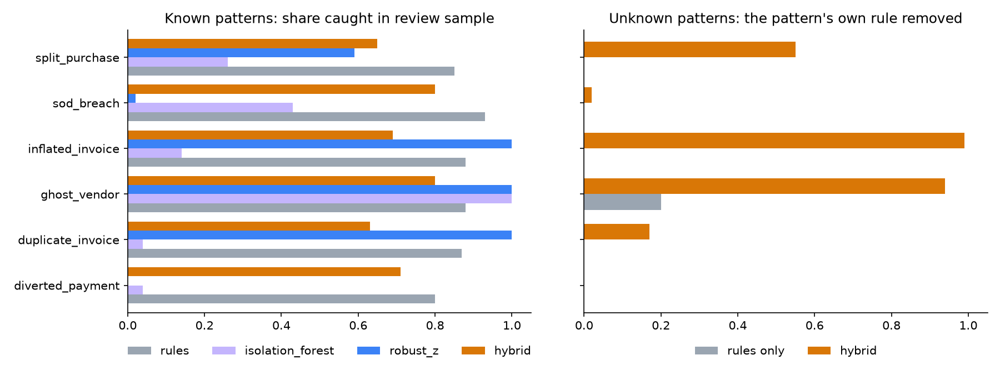
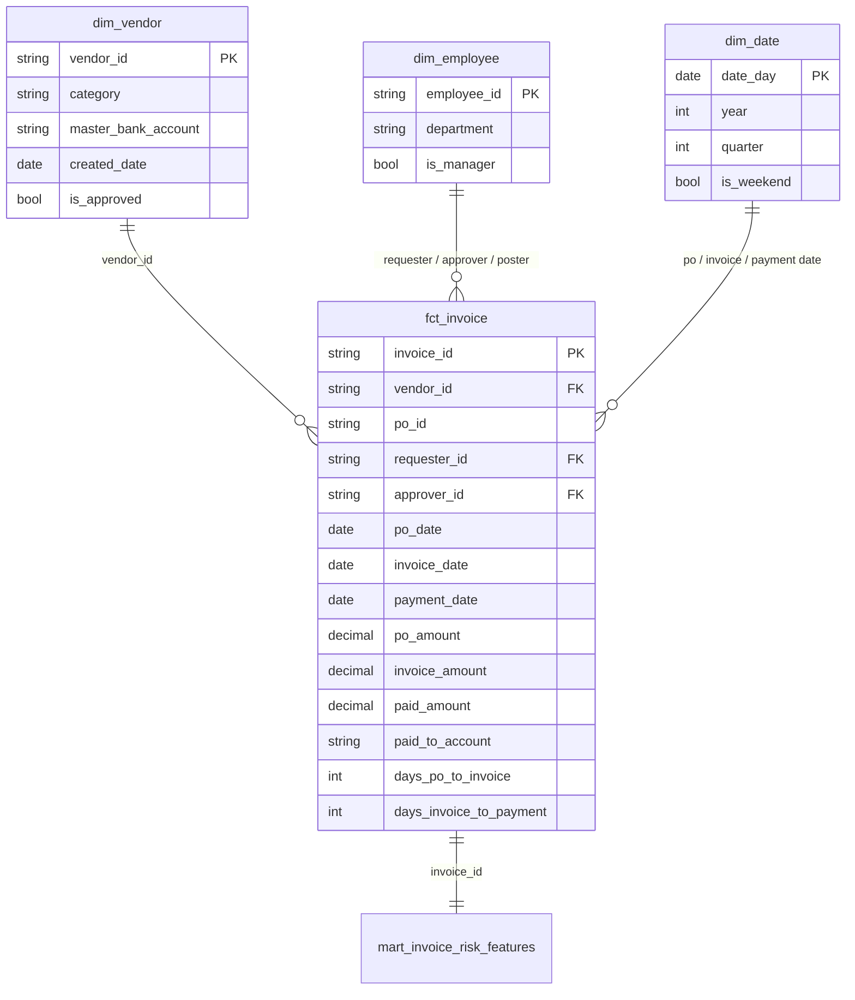

# Procure-to-Pay Audit Analytics

**A dbt + DuckDB dimensional model of a company's Procure-to-Pay (P2P) process, used to find invoice fraud with audit rules and unsupervised ML.**

Auditors can't review 25,000 invoices. They review a sample. This project builds the data model and risk scoring that decide *which* 500 invoices to review, and measures how much fraud that sample actually catches.



## Key findings

| Method | Precision@500 | Recall@500 | PR-AUC |
|---|---|---|---|
| Audit rules (6 red-flag tests) | 0.85 | 0.86 | 0.85 |
| Isolation Forest | 0.26 | 0.27 | 0.26 |
| Robust z-score (explainable outlier score) | 0.61 | 0.62 | 0.66 |
| **Hybrid**: 80% rules queue + 20% ML explore queue | 0.68 | 0.70 | n/a |

1. **Rules win on known fraud, and are blind to anything new.** Each rule catches 80–93% of the pattern it was written for. In the *blind-spot test*, each pattern's own rule is deleted (as if no one had thought of that fraud yet), and the rules catch 0–20% of it.
2. **Reserving 20% of the review budget for "unexplained outliers" catches fraud nobody wrote a rule for:** 94% of ghost vendors, 99% of inflated invoices, and 55% of split purchases, with no rule for them. The cost: overall recall falls from 0.86 to 0.70. That trade-off is a decision for the audit engagement lead, and the model makes it explicit.
3. **A simple robust z-score beat Isolation Forest by 2.5x on PR-AUC.** It also explains every alert: each invoice carries a `top_driver` (e.g. `invoice_to_po_ratio`), which an auditor can put in working papers. A black-box score can't be.
4. **Some risks are invisible to behavioural ML.** Diverted payments and segregation-of-duties breaches look numerically normal, so they need master-data and access controls rather than a model. Knowing what a model *can't* do matters as much as its score.

## Architecture

```
generate_data.py          dbt (DuckDB)                                    detect.py
──────────────────        ────────────────────────────────────────        ─────────────────────────
ERP extracts (CSV)  ──▶   staging  ──▶  star schema  ──▶  feature mart  ──▶  rules / ML scoring ──▶ review_sample.csv
+ answer key (hidden)     (types,       dims + fact      (audit flags +      evaluation vs answer   ml_invoice_risk_scores
                           renames)                       ML features)        key                    (written back to DB)
```

### Data model

`fct_invoice` is an **accumulating snapshot** fact (Kimball): one row per invoice, tracking its whole PO → invoice → payment lifecycle with milestone dates and lags.



**Data quality:** 17 dbt tests: primary-key uniqueness, not-null, referential integrity from fact to every dimension, plus business-rule tests (invoice not dated before its PO, payment equals invoice).

## The data

Real ledger data is confidential, and it has no labels. Nobody knows which invoices were fraud. So `generate_data.py` builds a realistic synthetic ERP extract (300 vendors, 80 employees, 25,280 invoices over 2 years) and **plants 6 fraud patterns from audit practice** (490 invoices, 1.9%):

| Pattern | What it looks like | Audit rule |
|---|---|---|
| Duplicate invoice | Same vendor and amount re-submitted days later, invoice no. tweaked (`-1`, `A`, `/R`) | same vendor + amount within 7 days |
| Split purchase | 3–4 self-approved POs on one day, each just under the ₹10k approval limit | ≥3 same-day POs at 85–100% of limit |
| Inflated invoice | Invoice 25–150% above its PO | invoice > PO + 10% |
| Ghost vendor | New, unapproved vendor paid large round sums within days | vendor not approved |
| SoD breach | Requester approves their own above-limit PO, posted on a weekend | requester = approver above limit |
| Diverted payment | Payment sent to a bank account that isn't on the vendor master | paid account ≠ master account |

The data also includes **legitimate noise that trips the rules**: fixed monthly fees (repeat amounts), genuine weekend work, and round-number POs. That's why rules alone aren't 100% precise.

The answer key (`data/labels.csv`) is read **only** in the evaluation section of `detect.py`. The model and scoring never see it.

## Run it

Requires [uv](https://docs.astral.sh/uv/).

```bash
make          # generate data -> dbt build (10 models + 17 tests) -> score & evaluate (~20s)
make docs     # browse the dbt lineage graph and column docs
```

Outputs: `results/metrics.md`, `results/recall_by_type.png`, `results/review_sample.csv` (the 500 invoices to review, each with its alert driver), and table `ml_invoice_risk_scores` in `p2p.duckdb`, ready for Power BI or Tableau.

## Project layout

```
generate_data.py                     synthetic ERP extract + planted anomalies
models/staging/                      typed, renamed views over raw CSVs (dbt sources)
models/marts/                        dim_vendor, dim_employee, dim_date, fct_invoice
models/marts/mart_invoice_risk_features.sql   audit flags + ML features, one row per invoice
tests/                               business-rule data tests
detect.py                            rules / Isolation Forest / robust-z / hybrid + evaluation
```

## Limitations and next steps

- Synthetic data: the patterns are realistic, but real fraud is more varied and adapts to controls. Validate on a real (anonymised) ledger before relying on the numbers.
- Thresholds (7-day duplicate window, 10% PO tolerance, 80/20 budget split) are hand-set. In an engagement they'd be agreed with the audit team and tuned on prior-year findings.
- Next: fuzzy vendor-name matching for duplicate vendors, Benford's-law test on amounts, and a Power BI dashboard on `ml_invoice_risk_scores`.

---
Built by [Anmol Bhandare](https://anmol7860-bit.github.io) · Python · SQL · dbt · DuckDB · scikit-learn
